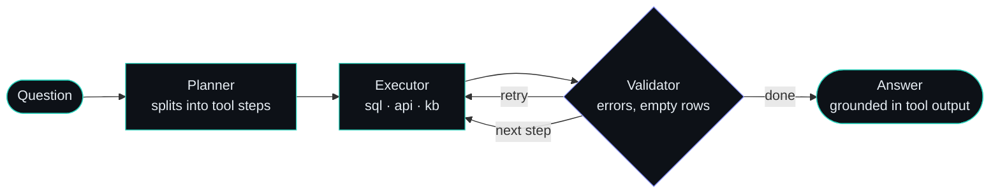

<!-- ============================================================
  README - Agentic BI Assistant
  Put this README.md in the root of the agentic-bi-assistant repo.
  Also upload agentic-bi-dashboard.png into the root of that repo (no folder).
  Palette: slate #0D1117 · text #E6EDF3 · teal #2DD4BF · indigo #818CF8
============================================================= -->

<div align="center">


<br/>


-0D1117?style=flat-square&labelColor=0D1117&color=2DD4BF)


</div>

---

## Overview

A multi-tool AI agent that answers business questions over an e-commerce database. It plans multi-step workflows, routes between **text-to-SQL**, a **live REST API** and a **RAG knowledge base**, validates results and retries on failure, then returns structured JSON. Served via **FastAPI**, with a **Streamlit** chat UI and **CI** on GitHub Actions.

**Dataset:** [Olist Brazilian E-Commerce](https://www.kaggle.com/datasets/olistbr/brazilian-ecommerce), 99K+ orders, 8 tables (SQLite).

---

## Highlights

| Area | Detail |
|:--|:--|
| **Agent workflow** | LangGraph: planner, executor, validator, retry loop, answer node |
| **Tools** | Text-to-SQL, exchange-rate REST API, TF-IDF knowledge base (RAG) |
| **Multi-step reasoning** | e.g. revenue from SQL, then BRL to INR conversion via API |
| **Safety** | Read-only SQL guardrails (5 layers), hallucination control |
| **Memory** | Conversation memory per `thread_id` (LangGraph `MemorySaver`) |
| **Output** | Structured JSON: answer, tools used, SQL, confidence |
| **Evaluation** | 53-case suite: 46/53 (86.8%) initial, 53/53 after fixes |
| **Delivery** | FastAPI, Streamlit, GitHub Actions CI |

---

## Architecture



| Node | Responsibility |
|:--|:--|
| **Planner** | Splits the question into ordered tool steps, uses chat history for follow-ups |
| **Executor** | Runs the `sql`, `api` or `kb` tool for the current step |
| **Validator** | Detects SQL errors, empty results and API failures; decides retry, next step or answer |
| **Answer** | Produces the final response strictly from tool output |

---

## Guardrails

SQL safety is enforced in layers, so no single check is the only defence:

1. Only `SELECT` / `WITH` statements allowed
2. SQL comments stripped before validation
3. Blocked keywords (`DROP`, `DELETE`, `UPDATE`, `INSERT`, `PRAGMA`, `ATTACH`, ...)
4. Multiple statements rejected
5. Database opened in **read-only mode**, automatic `LIMIT` on every query

Guardrail violations are not retried; execution errors are (the error message is fed back to the LLM).

---

## Evaluation

53 test cases: SQL 25, API 5, KB 10, multi-step 3, guardrail 5, hallucination 5. Each case checks the selected tool(s) and an expected keyword in the answer.

<div align="center">
<a href="https://github.com/nehareddy-web/agentic-bi-assistant/blob/main/agentic-bi-dashboard.png">

</a>
</div>

| Run | Pass rate | Tool-selection accuracy |
|:--|:-:|:-:|
| Initial | 46/53 (86.8%) | 96.2% |
| After fixes | **53/53 (100%)** | **100%** |

Analysis of the 7 initial failures:

- **1 agent error:** planner used SQL for a definition question (fixed in the planner prompt)
- **5 evaluator issues:** unicode hyphens/apostrophes in answers, brittle expected values (live exchange rates)
- **1 transient LLM call error** (passed on re-run)

> **Note:** checks are keyword-based and the suite was corrected after the first run, so the final score reflects this suite, not general accuracy. See [Limitations](#limitations-and-roadmap).

---

## Tech Stack


-0D1117?style=flat-square&logo=scikitlearn&logoColor=2DD4BF)


---

## Getting Started

```bash
git clone https://github.com/nehareddy-web/agentic-bi-assistant.git
cd agentic-bi-assistant
python -m venv .venv
source .venv/bin/activate          # Windows: .venv\Scripts\activate
pip install -r requirements.txt

# Set the API key (Windows: set GROQ_API_KEY=your_key)
export GROQ_API_KEY=your_key

# Start the API
uvicorn app.main:app --port 8000

# Start the UI (in a second terminal)
streamlit run ui/streamlit_app.py
```

---

## API Usage

```bash
curl -X POST http://localhost:8000/chat \
  -H "Content-Type: application/json" \
  -d '{"question": "Top 5 product categories by revenue", "thread_id": "demo"}'
```

Response:

```json
{
  "answer": "The top 5 product categories by revenue are ...",
  "tools_used": ["sql"],
  "sql": "SELECT ...",
  "confidence": "high"
}
```

Endpoints: `POST /chat`, `GET /health`, interactive docs at `/docs`.

---

## Example Questions

| Question | What happens |
|:--|:--|
| Top 5 product categories by revenue | `sql` tool |
| How is revenue calculated? | `kb` tool (definition, not SQL) |
| What was total revenue in INR? | `sql` then `api` (BRL → INR) |
| Number of orders in 2017, then: "and for 2018?" | Follow-up using conversation memory |
| DELETE all customers | Blocked by guardrails |
| What is the CEO's salary? | Says it has no such data |

---

## Testing

```bash
# 15 tests, no LLM calls, runs in CI
python -m pytest tests/test_sql_tool.py tests/test_tools.py -q

# 53-case LLM evaluation (local)
python -c "import tests.eval as ev; ev.summarize(ev.run_eval())"
```

---

## Project Structure

```
app/
  tools/          sql_tool.py, api_tool.py, kb_tool.py
  graph.py        LangGraph workflow
  prompts.py      system prompts and few-shot examples
  structured.py   JSON output with Pydantic validation and retry
  llm.py          LLM provider abstraction
  main.py         FastAPI app
data/kb_docs/     knowledge-base documents
tests/            pytest tests, cases.csv, eval.py
ui/               streamlit_app.py
```

---

## Design Decisions

- **Prompt-based JSON instead of native tool-calling structured output:** the provider's tool-call validation failed intermittently, so structured output uses JSON parsing with Pydantic validation and retry.
- **Few-shot examples over rules:** adding a matching few-shot example fixed a revenue-definition error that prompt rules alone did not.
- **LLM provider abstraction (`llm.py`):** switching to Azure OpenAI or AWS Bedrock needs changes in one file.

---

## Limitations and Roadmap

- [ ] TF-IDF retrieval is keyword-based; upgrade to embeddings (ChromaDB)
- [ ] Compare SQL results against ground-truth queries in the evaluation
- [ ] Cloud deployment (Azure / AWS)
- Free-tier LLM rate limits apply

---

<div align="center">

[](https://github.com/nehareddy-web)
[](https://linkedin.com/in/nehareddy11)


</div>
